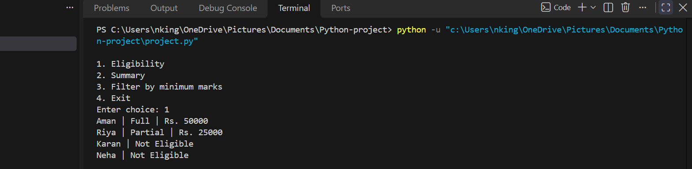
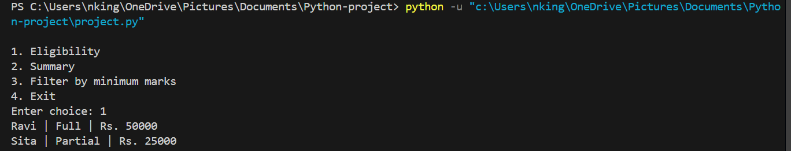
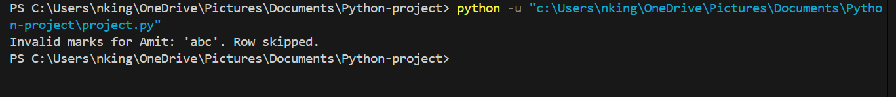
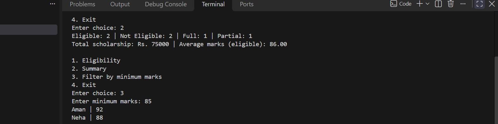

# Project Summary -- Student Scholarship Eligibility Analyzer

**PS No.:** 72\
**Project Title:** Student Scholarship Eligibility Analyzer\
**Language:** Python 3\
**Libraries:** Pandas, NumPy

------------------------------------------------------------------------

## 1. Project Overview

The Student Scholarship Eligibility Analyzer is a Python-based program
that reads student details from a CSV file and determines scholarship
eligibility using marks, annual family income, and attendance.

The program: - Loads student records from `students.csv` using Pandas. -
Validates the input and skips rows containing invalid or missing
values. - Checks eligibility and assigns the applicable scholarship. -
Displays each student's eligibility result. - Calculates a summary of
eligible students and scholarship funds. - Filters students according to
a user-entered minimum marks value.

## 2. Eligibility Criteria and Scholarship Rules

A student is **eligible** when all three conditions are satisfied:

  Criteria                      Requirement
  ---------------------- ------------------
  Attendance                        \>= 75%
  Marks                             \>= 75%
  Annual family income     \<= Rs. 5,00,000

Scholarship amount for eligible students:

  ------------------------------------------------------------------------
  Scholarship Type      Conditions                                  Amount
  --------------------- --------------------- ----------------------------
  Full                  Marks \>= 90% and                       Rs. 50,000
                        income \<= Rs.        
                        3,00,000              

  Partial               Eligible, but does                      Rs. 25,000
                        not meet both Full    
                        Scholarship           
                        conditions            

  Not Eligible          Fails any base                               Rs. 0
                        eligibility condition 
  ------------------------------------------------------------------------

## 3. Input CSV Format

The program reads a file named `students.csv` from the current working
directory. Each record contains four comma-separated fields:

``` csv
Name,Marks,Income,Attendance
Aman,92,250000,90
Riya,80,400000,85
Karan,60,200000,95
Neha,88,700000,80
```

The header row is optional. If present, it must use the column names
`Name,Marks,Income,Attendance`.

## 4. Program Features

1.  **Input validation:** Checks for missing values, invalid numeric
    values, non-finite numbers, marks or attendance outside the 0--100
    range, and negative income. Invalid records are skipped with a
    message.
2.  **Eligibility classification:** Uses conditional logic with NumPy to
    classify each student as Full, Partial, or Not Eligible.
3.  **Scholarship calculation:** Assigns Rs. 50,000 for Full and Rs.
    25,000 for Partial scholarships.
4.  **Summary report:** Displays eligible and not-eligible counts, Full
    and Partial counts, total scholarship amount, and average marks of
    eligible students.
5.  **Marks filtering:** Displays students whose marks are greater than
    or equal to the minimum marks entered by the user.

## 5. How to Run the Program

### Install the required libraries

``` bash
pip install pandas numpy
```

### Run the Python file

Keep `solution.py` and `students.csv` in the same folder, then run:

``` bash
python solution.py
```

The program displays a menu:

``` text
1. Eligibility
2. Summary
3. Filter by minimum marks
4. Exit
```

Enter the required menu option. For option 3, enter the minimum marks
when prompted.

## 6. Test Cases and Results

The following test cases are based on the project problem statement.

### Test Case 1 -- Normal Input

**Input (`students.csv`):**

``` csv
Aman,92,250000,90
Riya,80,400000,85
Karan,60,200000,95
Neha,88,700000,80
```

**Menu selection:** Option 1 -- Eligibility

**Expected result:**

``` text
Aman | Full | Rs. 50000
Riya | Partial | Rs. 25000
Karan | Not Eligible
Neha | Not Eligible
```

**Test Case 1 Screenshot**




------------------------------------------------------------------------

### Test Case 2 -- Boundary / Minimum Input

**Input (`students.csv`):**

``` csv
Ravi,90,300000,75
Sita,75,500000,75
```

**Menu selection:** Option 1 -- Eligibility

**Expected result:**

``` text
Ravi | Full | Rs. 50000
Sita | Partial | Rs. 25000
```

**Test Case 2 Screenshot**



------------------------------------------------------------------------

### Test Case 3 -- Invalid Input

**Input (`students.csv`):**

``` csv
Amit,abc,250000,80
```

**Expected result:**

``` text
Invalid marks for Amit: 'abc'. Row skipped.
```

**Test Case 3 Screenshot**




------------------------------------------------------------------------

### Test Case 4 -- Summary and Marks Filtering

**Input:** Use the same CSV data as Test Case 1.

**Menu selections:** - Option 2 -- Summary - Option 3 -- Filter by
minimum marks; enter `85`

**Expected result:**

``` text
Eligible: 2 | Not Eligible: 2 | Full: 1 | Partial: 1
Total scholarship: Rs. 75000 | Average marks (eligible): 86.00

Aman | 92
Neha | 88
```

**Test Case 4 Screenshot**




------------------------------------------------------------------------

## 7. Project Structure

``` text
Student-Scholarship-Eligibility-Analyzer/
│
├── solution.py
├── students.csv
├── README.md
├── summary.md
└── images/
    ├── test-case-1.png
    ├── test-case-2.png
    ├── test-case-3.png
    └── test-case-4.png
```

## 8. Conclusion

The project automates the process of checking student scholarship
eligibility using marks, family income, and attendance. It validates CSV
records, calculates scholarship amounts, generates a statistical
summary, and filters students by marks. The implementation uses Python 3
with Pandas and NumPy to perform data handling and conditional analysis.
